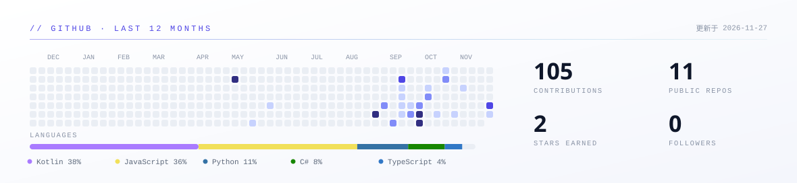

  <picture>
    <source media="(prefers-color-scheme: dark)" srcset="assets/hero-dark.svg">
    <source media="(prefers-color-scheme: light)" srcset="assets/hero-light.svg">
    
  </picture>

    
    
    
    
    

## 关于我

> 白天是高中生，晚上是 Vibe Coder。

- 🛠 喜欢把「顺手的小工具」真的做出来 —— 点歌铃、白板、用药提醒、配置备份……
- 🖥 主战场是 Windows 桌面（C# / WPF），也写 Android、浏览器插件和网页
- 🎧 写代码必听歌，歌多到听不过来，索性把 9 个音乐平台接进了同一个播放器
- 📝 折腾记录都写在[博客](https://chenyang-blog.pages.dev)里，欢迎来逛逛

## ✨ 精选项目

- 🎵 **[MusicBell 点歌铃](https://github.com/ChenyangLT/MusicBell)** &nbsp;`C#` `WPF` 
  给班级大屏用的定时自动点歌：日历点歌、点歌人统计、课程感知，还能和 ClassIsland 联动。

- 🖊 **[HoneySky White Board](https://github.com/ChenyangLT/HoneySky-White-Board)** &nbsp;`C#` `WPF` 
  白板书写与教学软件（Windows x64）—— 安装包、文档和[官网](https://chenyanglt.github.io/HoneySky-White-Board/)都在这。

- 🎧 **[ECHO 多平台音源](https://github.com/ChenyangLT/ECHO-Multi-Music-Sources)** &nbsp;`JavaScript` 
  把 9 个在线音乐平台接进同一个播放器：搜索、播放、歌单、歌词、MV 背景，[使用文档](https://chenyanglt.github.io/ECHO-Multi-Music-Sources/)。

- 💊 **[meditrack](https://github.com/ChenyangLT/meditrack)** &nbsp;`Kotlin` `Compose` 
  离线优先的用药提醒与记录：精确闹钟、后台守护、解锁补提醒、桌面小组件，没有网络权限。

## 🧩 更多作品

| 项目 | 一句话 |
| :-- | :-- |
| [CS2BackupTool](https://github.com/ChenyangLT/CS2BackupTool) | CS2 配置备份：Steam 730 / CFG 一键备份与跨用户恢复，内置 AI 逐行注释 |
| [Anti-MisOpen](https://github.com/ChenyangLT/Anti-MisOpen) | 防止重复双击导致程序多开的 Windows 小工具，免管理员权限 |
| [Bilibili-Privacy-Blocker](https://github.com/ChenyangLT/Bilibili-Privacy-Blocker) | B 站隐私遮挡、密码解锁、主页编辑的浏览器插件 |
| [ECHO 歌词翻译插件](https://github.com/ChenyangLT/ECHO-Player-Translation-Plugin) | 网易云歌词翻译，给 ECHO 播放器用的那个 |
| [ServerCommandMonitor](https://github.com/ChenyangLT/ServerCommandMonitor) | Minecraft 服务器：玩家执行指令监控插件 |

## 🧰 工具箱

    
    
    
    
    
    
    
    
    
    
    

## 📊 数据

  <picture>
    <source media="(prefers-color-scheme: dark)" srcset="assets/stats-dark.svg">
    <source media="(prefers-color-scheme: light)" srcset="assets/stats-light.svg">
    
  </picture>

## 📮 找到我

- 📝 博客：<https://chenyang-blog.pages.dev>
- 📺 B 站：[Chen_yang_LT](https://space.bilibili.com/3461567773411503)
- 🎵 网易云：[歌单在这里](https://music.163.com/#/user/home?id=4897598320)
- ✉️ 邮箱：<xcy20090423@163.com>

 

  用 ❤️ 和 AI 一起搭的 · 如果哪个项目帮到了你，点个 ⭐ 就够啦

